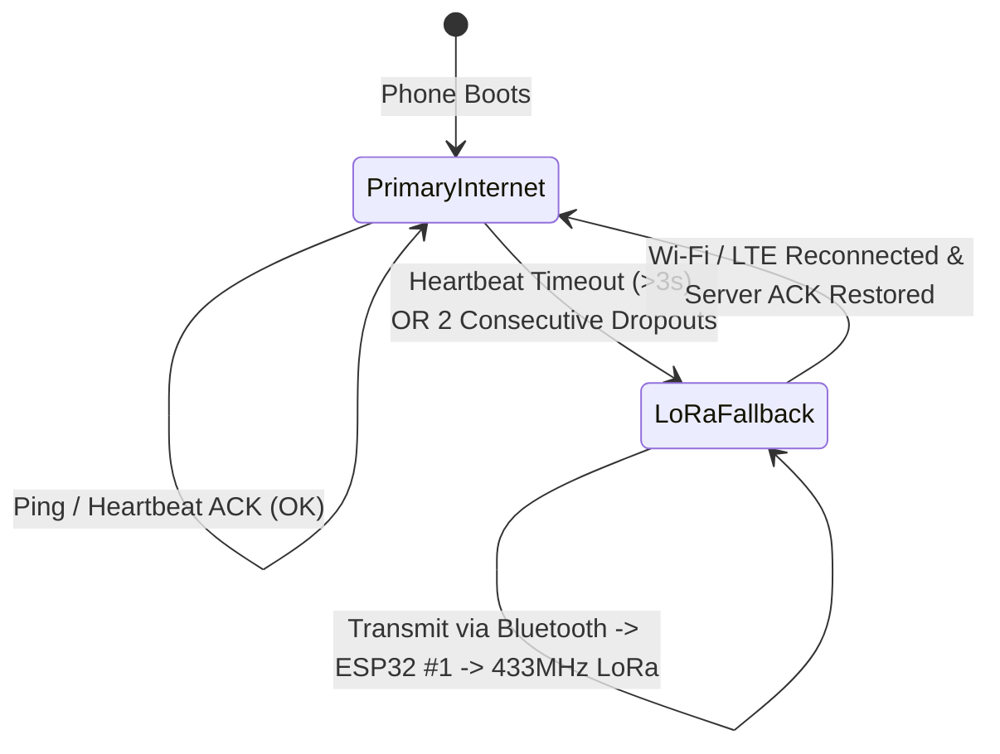

# SHEcurity System Architecture

## 1. High-Level System Architecture

```text
                               +-----------------------------+
                               |     ANDROID SMARTPHONE      |
                               |                             |
                               |  [GPS / Accelerometer / Gyro|
                               |  [GoBoult Fit Heart Rate]   |
                               |                             |
                               |      LOCAL RISK ENGINE      |
                               |   (0-100 Multi-Signal)      |
                               +--------------+--------------+
                                              |
                       +----------------------+----------------------+
                       |                                             |
            [Primary Transport]                             [Secondary Transport]
                       |                                             |
               Wi-Fi / Mobile LTE                             Bluetooth SPP
                       |                                             |
                       v                                             v
             HTTP REST / WebSocket                           ESP32 #1 Bridge
                       |                                             |
                       |                                    433 MHz SX1278 LoRa
                       |                                             |
                       |                                             v
                       |                                      ESP32 #2 Receiver
                       |                                             |
                       |                                         USB Serial
                       v                                             v
               +-----------------------------------------------------------+
               |               LAPTOP MONITORING DASHBOARD                 |
               |                                                           |
               |  - Live Geospatial Map (Leaflet)                          |
               |  - Explainable Risk Breakdown                             |
               |  - Real-Time Heart Rate & Movement Telemetry              |
               |  - Dual Communication Matrix                              |
               |  - Discreet "Are You Safe?" Remote Challenge              |
               +-----------------------------------------------------------+
```

---

## 2. Dynamic Risk Scoring Model

The Android phone calculates the risk score strictly on-device using a weighted anomaly model:

$$\text{RiskScore} = \min\left(100, \max\left(0, S_{\text{route}} + S_{\text{time}} + S_{\text{motion}} + S_{\text{heartRate}} - S_{\text{safeContext}}\right)\right)$$

### Factor Weights

| Signal Factor | Normal (0 pts) | Moderate Anomaly | Critical Anomaly |
| :--- | :--- | :--- | :--- |
| **Route Deviation ($S_{\text{route}}$)** | Distance $\le 100\text{m}$ to safe route corridor | Deviation $101 - 250\text{m}$ (+10 pts) | Deviation $> 500\text{m}$ (+25 pts) |
| **Time Anomaly ($S_{\text{time}}$)** | Within scheduled routine (e.g. 5–10 PM) | Late evening 10–11 PM (+15 pts) | Curfew / Midnight 11 PM–4 AM (+25 pts) |
| **Motion Anomaly ($S_{\text{motion}}$)** | Stationary or normal walking cadence | Unusual sudden acceleration | Running (+25 pts) or Fall/Impact (+30 pts) |
| **Heart Rate ($S_{\text{heartRate}}$)** | $60 - 95\text{ BPM}$ | $100 - 130\text{ BPM}$ (+15 pts) | Tachycardia / Panic $> 135\text{ BPM}$ (+25 pts) |
| **Safe Context ($S_{\text{safeContext}}$)** | Outside known areas | Proximity buffer | Inside Home/Hostel/Campus ($-25\text{ pts}$) |

### Dynamic Risk Decay
When a user deviates temporarily (e.g., stopping at a café or friend's house) but movement remains calm and heart rate stays normal, the elevated risk decays by 8–10 points every evaluation cycle until baseline is reached, effectively eliminating false alarms.

---

## 3. Communication Failover State Machine



---

## 4. GoBoult Fit Integration Workflow

1. User triggers heart rate measurement in SHEcurity or opens GoBoult Fit.
2. `BoultFitHeartRateService` (Accessibility Service) inspects active window nodes.
3. Automatically triggers "Measure" action.
4. GoBoult Fit displays previous cached measurement at the top. The new measurement completes and displays at the bottom with timestamp.
5. The service parses the bottom-most integer BPM via regular expression `(\d{2,3})\s*bpm`.
6. Verified BPM is passed directly to `RiskEngine`.
